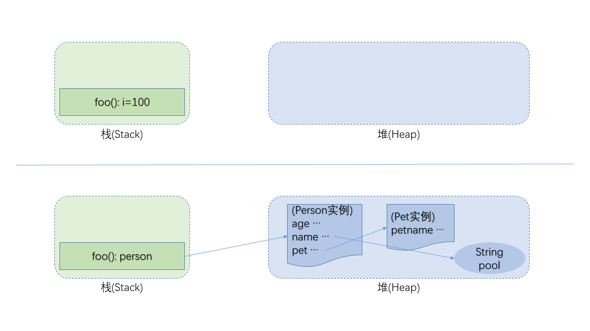

代码片段
```java
class Person {
  private int age;
  private String name;
  private Pet pet;
  public void foo(int param){
    int i = 100;
    // Person person = new Person();
  }
}
```
#### 本地变量(local variable) vs. 成员变量/实例变量(instance variable)
本地变量指在方法中声明的变量，以及方法参数，如例子中的param，i。成员变量指不是在方法中声明的对象，如例子中的age，name。

#### 原始类型(primitive type) vs. 引用类型/对象类型
原始类型是指boolean, char, byte, short, int, long, float, double。引用类型是指除以上之外的其他类型。

#### 数据结构的栈 vs. Java内存中的栈区
栈是一种后进先出的数据结构，类似于叠盘子，最后叠上的盘子，总是最先被取走。Java内存中的栈区是基于数据结构的栈开辟的一块内存区域，所以该区域也遵循后进先出的顺序。

#### StackOverflowError vs. OutOfMemoryError: Java heap space
StackOverflowError通常是递归太深导致的。OutOfMemoryError: Java heap space通常是系统确实需要较多的堆空间，或者存在内存泄漏。</p>

#### 栈区存储内容 vs. 堆区存储内容
<font color="red">栈区存储本地变量。</font> 这分为两部分，对于原始类型，其值就直接存在栈区中，对于引用类型，其引用地址存储在栈区中，真正的对象则存储在堆区中。而成员变量，无论是原始类型还是引用类型，都存储在堆区中。

如果你在方法foo()中创建一个原始类型变量，那么对应的值就存在栈区中。如果你在方法foo()中创建了一个引用类型变量，如person，那么存在栈区中的是引用地址。注意，图中person对象有一个成员变量pet，这是一个引用类型，所以在person对象中，只保存了pet对象的引用地址，它指向堆区中的另外一块区域(即pet对象)。




