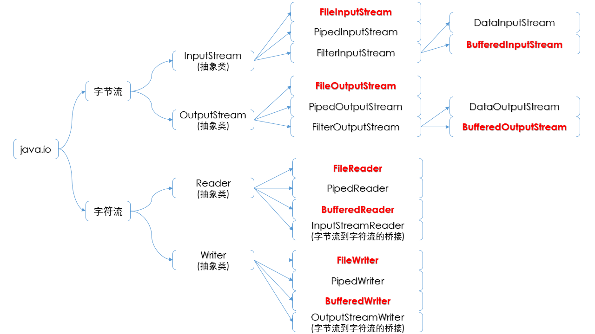

- 可以分为输入流(外部->Java程序)、输出流(Java程序->外部)
- 可以分为字节流(名称带Stream后缀，每次处理一个字节)、字符流(名称带Reader/Writer后缀，每次处理一个字符)
- 带Buffered字样的，一次处理若干个字节/字符，绝大多数情况下建议使用，以提高IO性能。
- 不同的流可以嵌套使用，最常见的是在各类裸流外面套用Buffered流。

下图仅列出部分IO相关类，





### 文件读写示例
```java
private static void charRead() {
	File file = new File("/home/codelib/foobar.txt");
	try (FileReader fr = new FileReader(file)) {
		char[] chars = new char[(int) file.length()];
		fr.read(chars);
		logger.info(new String(chars));
	} catch (IOException e) {
		//
	}
}

private static void charReadWithBuffer() {
	File file = new File("/home/codelib/foobar.txt");
	// default buffer size 8k
	try (BufferedReader br = new BufferedReader(new FileReader(file))) {
		// here we have the great read-line function
		String line = null;
		while ((line = br.readLine()) != null) {
			logger.info(line);
		}
	} catch (IOException e) {
		//
	}
}

private static void charReadWithEncoding() {
	File file = new File("/home/codelib/foobar.txt");
	try (BufferedReader br = new BufferedReader(new InputStreamReader(new FileInputStream(file), "UTF-8"))) {
		String line = null;
		while ((line = br.readLine()) != null) {
			logger.info(line);
		}
	} catch (IOException e) {
		//
	}
}

private static void charWrite() {
	File file = new File("/home/codelib/foobar.txt");
	try (FileWriter fw = new FileWriter(file)) {
		fw.write("foobar");
	} catch (IOException e) {
		//
	}
}

private static void charWriteWithBuffer() {
	File file = new File("/home/codelib/foobar.txt");
	try (BufferedWriter bw = new BufferedWriter(new FileWriter(file))) {
		bw.write("foobar");
		bw.newLine();
		bw.write("dummy");
	} catch (IOException e) {
		//
	}
}	

private static void charWriteWithEncoding() {
	File file = new File("/home/codelib/foobar.txt");
	try (BufferedWriter bw = new BufferedWriter(new OutputStreamWriter(new FileOutputStream(file), StandardCharsets.UTF_8))) {
		bw.write("文件");
		bw.newLine();
		bw.write("ぶんしょ");
	} catch (IOException e) {
		//
	}
}
```

### 字节操作示例
```java
private static void byteWrite() {
	File file = new File("/home/codelib/foobar.dat");
	try (DataOutputStream fo = new DataOutputStream(new FileOutputStream(file))) {
		Integer i = 10086;
		fo.writeInt(i); 
		String x = "10086";
		byte[] bs = x.getBytes(Charset.forName("UTF8"));
		fo.writeInt(bs.length);
		fo.write(bs);
	} catch (IOException e) {
		//
	}
}

private static void byteRead() {
	File file = new File("/home/codelib/foobar.dat");
	try (DataInputStream fo = new DataInputStream(new FileInputStream(file))) {
		byte[] bs = new byte[100];
		fo.read(bs);
		//
		byte[] key = new byte[4];
		System.arraycopy(bs, 0, key, 0, 4);
		logger.info(fromByteArray(key));
		byte[] header = new byte[4];
		System.arraycopy(bs, 4, header, 0, 4);
		int vsize = fromByteArray(header);
		byte[] cp = new byte[vsize];
		System.arraycopy(bs, 8, cp, 0, vsize);
		logger.info(new String(cp, Charset.forName("UTF8")));
	} catch (IOException e) {
		//
	}
}

static int fromByteArray(byte[] bytes) {
	return ByteBuffer.wrap(bytes).getInt();
}

static byte[] toByteArray(int value) {
	return ByteBuffer.allocate(4).putInt(value).array();
}
```

### 二进制文件/文本文件
计算机中的所有数据，不论是文字、图片、视频，最终都是以二进制的形式进行存储。日常说的“文本文件”是二进制之上的一层概念，其底层当然也是二进制。读取的时候，二进制转成字节，一个或几个字节按一定的规则(即编码，比如UTF-8、ASCII等)映射成一个字符，这个映射的过程日常由文本编辑器等应用程序来完成。

有些内容，可以按文本方式，也可以按二进制方式，举例，整型数字10086，可以选择按文本方式，5个字符，按UTF8变长编码，占用5个字节。如果直接按二进制表示，一般整型只占4字节，两种方式体积有差别。

### IO与Kernel Memory
IO操作是以块(block)为单位，一般为4KB，如果是这样，那么，使用小于4KB的buffer是否就没有意义了？这里需要注意的是，这个4KB是被读入到操作系统的kernel memory，而外部的应用程序(以FileInputStream为例)，仍然是一个字节一个字节的从kernel memory读取。

在循环读取的过程中，kernel memory可能会由于时效性需要重新从磁盘读取。假设你需要读取5个字节，没有buffer的情况下，需要对kernel memory进行5次询问，而kernel memory可能的读盘次数是0~5次。由此可见，使用小于4KB（block的大小）的buffer，对提高性能仍然是有帮助，可以减少潜在的重新从磁盘读入到kernel memory的过程。

需要注意的是，FileReader父类中默认使用了8KB的buffer(最小buffer 32B)，所以裸用FileReader并不会导致逐个char读取。


