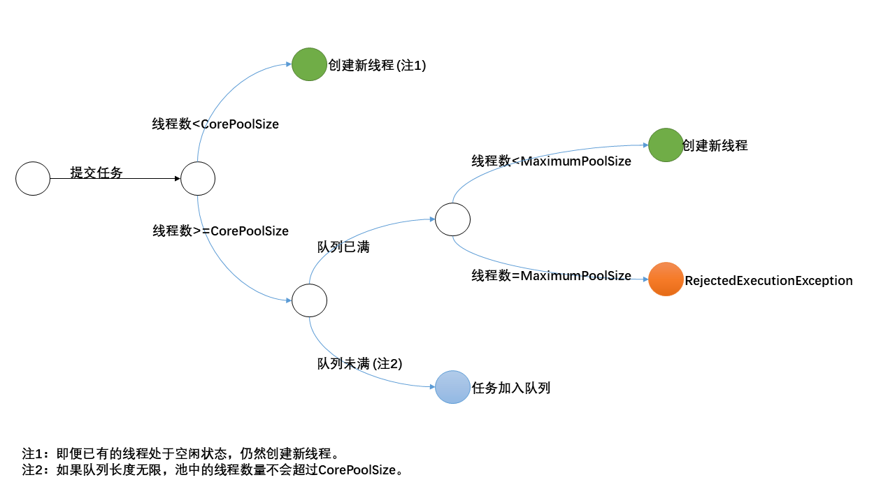

> ThreadPoolExecutor允许我们提交任务，但这并不是毫无限制的，一些情况下会引起RejectedExecutionException。

### CorePoolSize, MaximumPoolSize




### 队列的类型
1. SynchronousQueue，0长度，相当于没有队列
2. ArrayBlockingQueue，有限长度
3. LinkedBlockingQueue，无限长度

### KeepAliveTime
空闲线程的存活时长，如果某一线程的空闲时长超过KeepAliveTime，并且池中的线程数量大于CorePoolSize，该线程将被终止。

### 代码示例
```java
public class ThreadPoolExecutorDemo {
  public static class Job implements Runnable {
    private String name;
    public Job(String p) {
      name = p;
    }
    public String getName() {
      return name;
    }
    public void setName(String name) {
      this.name = name;
    }
    @Override
    public void run() {
      try {
        Thread curThread = Thread.currentThread();
        System.out.println(curThread.getName() + ": start " + name);
        Thread.sleep(300);
        System.out.println(curThread.getName() + ": finished  " + name);
      } catch (Exception e) {
        System.out.println(e);
      }
    }
  }
  
  private static final int POOL_CORE_SIZE = 5;
  private static final int POOL_MAX_SIZE = 10;
  public static void main(String[] args) {
    ExecutorService es1 = createExecutorWithSynchronousQueue();
    // 任务数量超过10 (POOL_MAX_SIZE)，触发RejectedExecutionException: 
    // Exception in thread "main" java.util.concurrent.RejectedExecutionException: Task ... rejected from java.util.concurrent.ThreadPoolExecutor@46f5331a[Running, pool size = 10, active threads = 8, queued tasks = 0, completed tasks = 0]
    for (int i = 0; i < 11; i++) {
      Job job = new Job("Job-" + i);
      es1.execute(job);
    }
    es1.shutdown();
    
    ExecutorService es2 = createExecutorWithArrayBlockingQueue();
    // 任务数量超过20 (POOL_MAX_SIZE + Queue)，触发RejectedExecutionException
    for (int i = 0; i < 21; i++) {
      Job job = new Job("Job-" + i);
      es2.execute(job);
    }
    es2.shutdown();
    
    ExecutorService es3 = createExecutorWithLinkedBlockingQueue();
	// 不会触发RejectedExecutionException
    for (int i = 0; i < 100; i++) {
      Job job = new Job("Job-" + i);
      es3.execute(job);
    }
    es3.shutdown();
  }
  public static ThreadPoolExecutor createExecutorWithSynchronousQueue() {
    // Executors#newCachedThreadPool()等效于new ThreadPoolExecutor(0, Integer.MAX_VALUE, 60L, TimeUnit.SECONDS, new SynchronousQueue<Runnable&gt;())
    // SynchronousQueue意味着Queue长度为0。
    ThreadPoolExecutor et = (ThreadPoolExecutor) Executors.newCachedThreadPool();
    et.setKeepAliveTime(60L, TimeUnit.SECONDS);
    et.setCorePoolSize(POOL_CORE_SIZE);
    et.setMaximumPoolSize(POOL_MAX_SIZE);
    return et;
  }
  public static ThreadPoolExecutor createExecutorWithArrayBlockingQueue() {
    // ArrayBlockingQueue为有限长度的Queue，此处长度为10
    ThreadPoolExecutor et = new ThreadPoolExecutor(POOL_CORE_SIZE, POOL_MAX_SIZE, 60L, TimeUnit.SECONDS, new ArrayBlockingQueue<Runnable&gt;(10));
    return et;
  }
  public static ThreadPoolExecutor createExecutorWithLinkedBlockingQueue() {
    // LinkedBlockingQueue为无限长度的Queue
    ThreadPoolExecutor et = new ThreadPoolExecutor(POOL_CORE_SIZE, POOL_MAX_SIZE, 60L, TimeUnit.SECONDS, new LinkedBlockingQueue<Runnable&gt;());
    return et;
  }
}
```