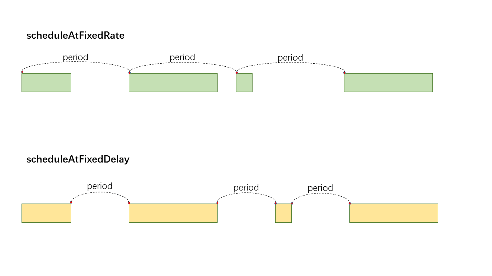

> ScheduledExecutorService支持日常的定时执行场景，与Timer类似，不过Timer是单线程的，如果有多个定时任务，需要实例化多个Timer，但我们可以向一个ScheduledExecutorService提交多个定时任务。

### 两种行为方式
ScheduledExecutorService有两个方法，
1. scheduleAtFixedRate
2. scheduleAtFixedDelay  

scheduleAtFixedRate的period是两次任务的开始时间之间的间隔，scheduleAtFixedDelay的period是指一次任务的结束时间到下一次任务的开始时间之间的间隔。下图的矩形方块表示任务执行时长。  





### 任务超时
scheduleAtFixedRate`无法保证按时执行`，当任务执行时间超过period，就会导致后续的任务被堵塞，造成执行时间点的紊乱。

注：scheduleAtFixedRate的设计时，其中一个点就是要避免同一个schedule的多个任务实例出现重叠，因此假设schedule设置的间隔是5s，第一个实例用了6s，那么第二个实例会从6s开始跑，避免出现overlap，这个特性和你在初始化是使用几个线程无关，`所以提高线程数量并不能解决这个问题`。

除此之外，还有一个原因，如果允许同一schedule的不同任务实例overlap，那么很可能会完全耗尽线程池中的线程。

既然是一个接一个跑，那么初始化时`Executors.newScheduledThreadPool(5)`使用5个线程的意义何在？这些多线程，是给多个schedule使用的，不是给一个schedule中的多个实例使用的：

```java
es.scheduleAtFixedRate(taskA, 0L, 500L, TimeUnit.SECONDS);
es.scheduleAtFixedRate(taskB, 0L, 200L, TimeUnit.SECONDS);
es.scheduleAtFixedRate(taskC, 0L, 300L, TimeUnit.SECONDS);
```

如果前后任务之间没有依赖关系，而又确实需要保证同一个schedule中的多个任务实例都按时start，可以考虑把任务自身改成异步执行:

```java
ScheduledExecutorService es = Executors.newScheduledThreadPool(5);
ScheduledFuture<?> f = es.scheduleAtFixedRate(new Runnable() {
	@Override
	public void run() {
		// 由于submit是异步提交，这里不会出现执行时间超长的情况。
		// 这里复用了es，所以仍然需要估算es线程池的大小。
		Future f = es.submit(() -> ......); 
		// 可以考虑将future放入一个集合，以便在有需要的情况下对它们进行操作。
		// 例如可以使用一个单独的schedule，对超过一定时间的future进行cancel。
		futures.put(System.currentTimeMillis(), f); 
	}
}, 0L, 5L, TimeUnit.SECONDS);
```

### 异常处理
scheduleAtFixedRate/scheduleAtFixedDelay如果某一次执行出现异常，
1. 不会打印异常信息
2. 后续任务不会执行
3. ScheduledExecutorService本身仍然存活  

这种现象容易误导对问题的定位，一种粗暴的方式，是直接捕获所有的Exception甚至是Throwable，记录错误日志并作出后续处理。
```java
ScheduledExecutorService es = Executors.newSingleThreadScheduledExecutor();
ScheduledFuture<?> f = es.scheduleAtFixedRate(new Runnable() {
	@Override
	public void run() {
		try {
			......
		} catch (Throwable e) {
			log.error(...); // 记录日志
			// 对不同的Exception/Error进行处理，例如在某些情况下关闭线程池
			if ( e instanceof ...) {
				es.shutdown();
			} else {
				// swallow
			}
		}
	}
}, 0L, 5L, TimeUnit.SECONDS);
```