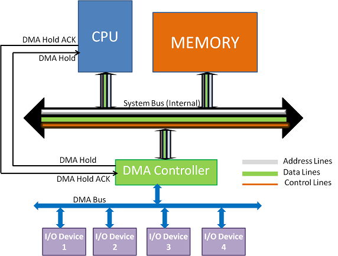
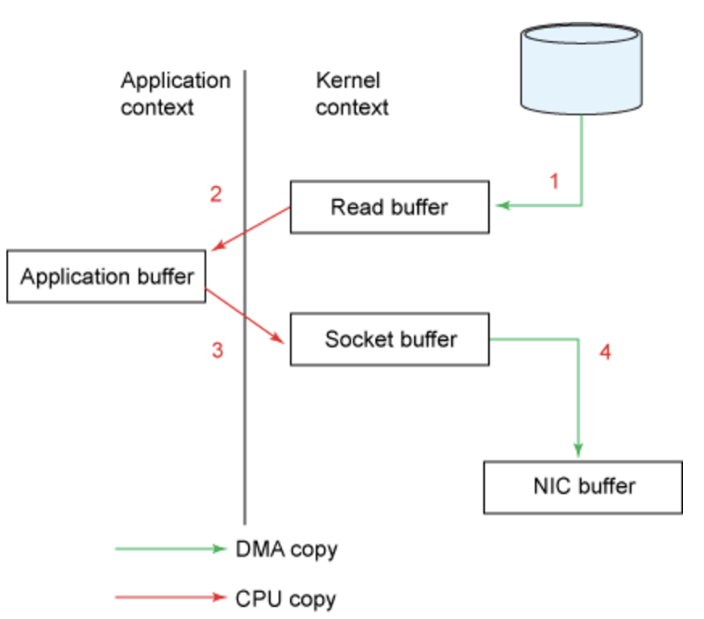
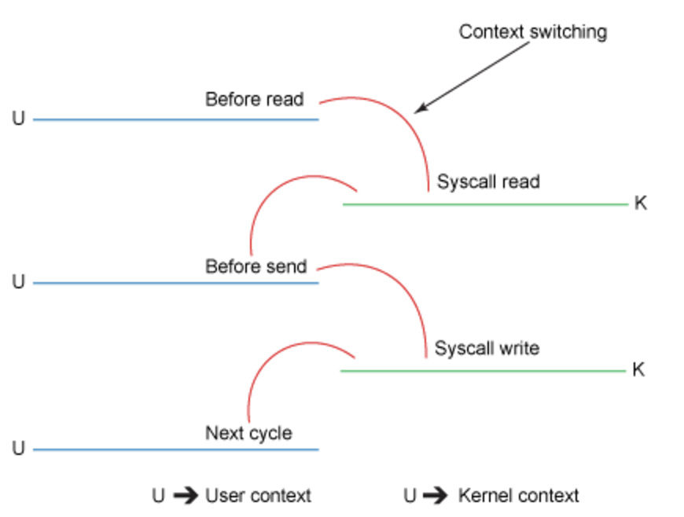
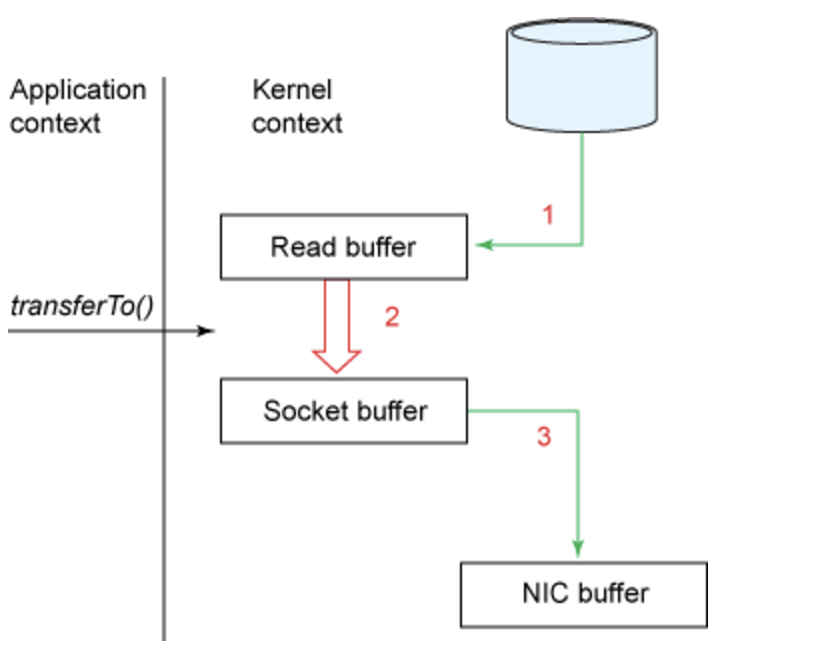
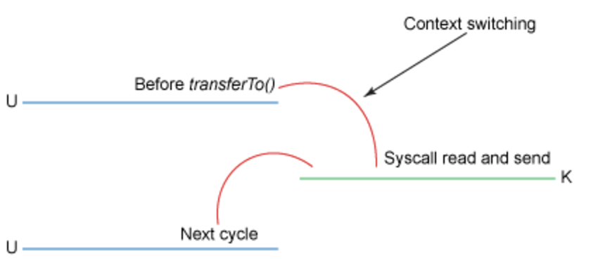
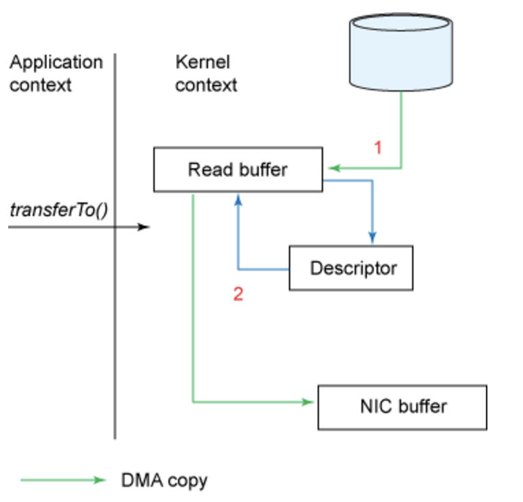

# 背景知识

## 缓冲区缓存（Buffer Cache）

**缓冲区(buffer)**: 缓冲区是用来协调不同速度的设备或进程之间的数据传输，隐含着一个“数据累积”过程，以便后续进行数据转移。应用程序可以有缓冲区、内核可以有缓冲区、硬件设备也可以有缓冲区（如磁盘缓冲区）。Java IO 中，带 Buffered 字样的类都是使用缓冲区的（并不表示不带 Buffered 字样的就不使用缓冲区，我记得 FileReader 默认是使用缓冲区的）。

**缓存(cache)**: 缓存保存了最近使用过或者频繁使用的数据，以便后续有应用程序读取相同数据时，无需再次对较慢的数据源（如磁盘）进行访问。

**缓冲区缓存（Buffer Cache）/页缓存（Page Cache）**：早前的 Linux 操作系统中 Buffer Cache 和 Page Cache 是各自独立的，2.4 之后它们统一了，两种叫法可互换使用。个人觉得叫 Buffer Cache 好一点，体现兼具缓冲区和缓存的功能：在读取文件时，它像一个 Cache；而在写入文件时，它更像一个 Buffer。


## DMA

最早的数据拷贝都需要 CPU 负责，数据需要经过 CPU 寄存器才能从 A 处传到 B 处，寄存器与 CPU 集成，速度极快，但容量一般只有几十个 bit（32 或 64 bit），大量的数据传输会使 CPU 疲于奔命，效率低下。

DMA 是一种硬件技术，依赖于“DMA 控制器”芯片，它减少 CPU 在数据传输过程中的负担。CPU 可以将一些数据传输任务委托给 DMA 控制器，例如让它负责从磁盘读取数据到 Buffer Cache，这样 CPU 就可以去忙别的事了。这不是一项新技术，早在 1960s 就出现了。





## 内核态与用户态
内核态（Kernel Mode）与用户态（User Mode）是操作系统中定义的两种不同的处理器运行级别，它们用于区分系统内部操作和应用程序操作的不同权限级别，这种隔离主要是出于稳定性和安全性的考虑。

通常，当用户的应用程序触发了内核接口（即所谓的“系统调用（System Call）”），CPU 会从用户态切换到内核态。例如，当应用程序调用 C 标准库函数 fread() 时，就会触发 read() 系统调用，此时，CPU 就需要从用户态切换到内核态来执行该系统调用；一旦内核完成了该系统调用的工作，它会将控制权返回给用户程序，使 CPU 重新进入用户态。


# 传统数据传输

假设我们读取磁盘文件，并通过 socket 发送到远端：
```java
FileInputStream inputStream = new FileInputStream(fname);
DataOutputStream output = new DataOutputStream(socket.getOutputStream());
long start = System.currentTimeMillis();
byte[] b = new byte[4096];
long read = 0, total = 0;
while ((read = inputStream.read(b)) >= 0) {
    total = total + read;
    output.write(b);
}
```

数据传输流程是这样的：






应用程序 read() 方法，它会触发 sys_read() 系统调用，因此会发生从用户态切换到内核态的上下文切换，当 sys_read() 系统调用完成，又会从内核态切换回用户态，一共是2次上下文切换。类似的，应用程序 send() 方法也会触发 sys_send() 系统调用，前后也有2次上下文切换。所以，总共发生了4次上下文切换。

另外，sys_read() 系统调用会触发 DMA 将数据从磁盘缓冲区拷贝到内核 Buffer Cache（对于磁盘文件读取场景，图中的 read buffer 应该是更广泛的 Buffer Cache 的一部分），接着还会触发内核将数据从 Buffer Cache 拷贝到应用程序缓冲区，一共是2次数据拷贝。类似的，sys_send() 系统调用会触发内核将数据从用户缓冲区拷贝到 socket buffer，接着还会触发 DMA 将数据从 socket buffer 拷贝到网卡缓冲区。所以，总共发生了4次数据拷贝。

这里有两个问题：一是为何数据需要先经过 Buffer Cache，而非直接进入用户缓冲区？二是对于只是读取数据并原样发送的场景，数据是否有必要拷贝到应用程序缓冲区？

第一个问题，这个流程的初衷恰恰是为了提高性能。在读取时，Buffer Cache 可以进行“预读”，即读入应用程序尚未要求，但后续极有可能会请求的数据。这在请求的数据量小于 Buffer Cache 大小时显著提高了性能。而在写入时，Buffer Cache 允许写操作异步完成（异步是指：当数据被拷贝到 Buffer Cache 后，应用程序就返回了，而不需要等待数据真正被写出到磁盘或网络），同样可以提高性能。不过，当应用程序请求的数据显著大于 Buffer Cache 时，这个方案本身会成为一个性能瓶颈：数据在磁盘、 Buffer Cache、用户缓冲区直接被多次拷贝之后，才会到达应用程序。

第二个问题，答案是没有必要。而我们要介绍的零拷贝技术，就包括移除这类不必要的数据拷贝。


# Java 零拷贝：FileChannel.transferTo()

假设数据不需要修改（有许多场景，数据只需要原样传输，例如传输静态网页、图片等），因此传统流程中，至少第二次和第三次的数据拷贝明显是没有必要的，数据可以直接从 Buffer Cache 传输到 socket buffer，使用 Java NIO transferTo() 方法可以实现这一目的。

```java
SocketAddress sad = new InetSocketAddress(host, port);
SocketChannel sc = SocketChannel.open();
......
long fsize = 183678375L, sendzise = 4094;
FileChannel fc = new FileInputStream(fname).getChannel();
long start = System.currentTimeMillis();
long nsent = 0, curnset = 0;
curnset = fc.transferTo(0, fsize, sc);
```

transferTo() 方法将数据从文件通道传输到给定的 socket 通道。内部依赖于底层操作系统的零拷贝支持，在 UNIX/Linux 系统中，它背后使用的是 sendfile() 系统调用。







1. transferTo() 会首先将触发 DMA 将数据从磁盘缓存拷贝到 Buffer Cache。
2. 内核将数据从 Buffer Cache 拷贝到 socket buffer 。
3. DMA 将数据从 socket buffer 拷贝到网卡缓冲区（即图中的 NIC buffer）。

由于只有一次 sendfile() 系统调用，上下文切换从4个降低到2个，数据拷贝从4次降低到3次，其中只有第二次需要 CPU 参与，剩余2次都是 DMA 代劳。

如果网卡支持聚集操作“gather operations”，则可以进一步减少数据拷贝：





1. transferTo() 会首先将触发 DMA 将数据从磁盘缓存拷贝到 Buffer Cache。
2. 数据不会被拷贝到 socket buffer。相反的，只有文件位置、长度等少量描述信息被写入 socket buffer。DMA 直接将数据从 Buffer Cache 写入网卡缓冲区。

这样，上下文切换还是2个，数据拷贝则降到了2次（都不需要 CPU 参与）。


# Java 零拷贝：FileChannel.map()

除了`FileChannel.transferTo()`，Java NIO 中还有另外一类技术可用于减少数据拷贝和上下文切换，即`FileChannel.map()`方法，该方法依赖于 mmap 系统调用。

应用进程调用了 mmap() 后，DMA 会把磁盘的数据拷贝到内核 Buffer Cache，随后 Buffer Cache 里的数据会被“映射”到用户空间，这样，应用程序就可以操作数据，而无需先把数据从 Buffer Cache 拷贝到应用程序缓冲区。


以下是 map() 方法读写数据的示例：
```java
// mmap 读操作简单示例：
try (RandomAccessFile raf = new RandomAccessFile(filename, "r");
     FileChannel fileChannel = raf.getChannel()) {
    long fileSize = fileChannel.size();
    MappedByteBuffer mappedByteBuffer = fileChannel.map(FileChannel.MapMode.READ_ONLY, 0, fileSize);
    byte[] data = new byte[(int) fileSize];
    mappedByteBuffer.get(data);
    System.out.println("File content: " + new String(data));
} catch (Exception e) {
    e.printStackTrace();
}

// mmap 写操作简单示例：
String filename = "foo.txt";
String message = "Hello World!";
try (RandomAccessFile raf = new RandomAccessFile(filename, "rw");
     FileChannel fileChannel = raf.getChannel()) {
    long fileSize = fileChannel.size();
    // 注意这里不能使用 fileSize + message.length()，应该使用fileSize + message.getBytes().length，否则当 message 中有非 ascii 字符时会报溢出错误：
    // java.nio.BufferOverflowException
    MappedByteBuffer mappedByteBuffer = fileChannel.map(FileChannel.MapMode.READ_WRITE, 0, fileSize + message.getBytes().length);
    mappedByteBuffer.position((int) fileSize);
    mappedByteBuffer.put(message.getBytes());
} catch (Exception e) {
    e.printStackTrace();
}
```


# 零拷贝在大数据领域的应用

大数据处理经常需要进行 shuffle 操作，即数据的重新分区，该操作存在大量的数据传输，而在一些子步骤（如 spill merge）中，零拷贝可以发挥作用。

以 Spark 为例，输入数据被分为不同的“分片”，一个 map task 负责处理一个分片。除去古老的 hash-based shuffle，目前默认使用的 sort-based shuffle 以及可选的 tungsten shuffle，规定一个 map task 只能输出一个本地数据文件，以缓解 hash-based shuffle 中生成的文件数量过多的问题。

> 注1：分片：Spark 术语叫 partition，注意它与 reduce 阶段的 partition 不是一个概念，前者与数据内容无关，是对数据的简单分割；后者通常是根据数据中某个具体字段进行分区。
> 注2：map task：对于 shuffle 操作，一般将它分为两个阶段：map 阶段、reduce 阶段，前者会进行 shuffle write，后者则会进行 shuffle read。
> 注3：事实上，在数据文件之外，还会生成一个索引文件，用于记录各个 partition 数据在数据文件中的位置。

如果一个分片的数据量不大，map task 会在内存中完成相关工作，然后在输出阶段（即 shuffle write）直接输出一个最终文件即可。如果分片的数据量较大，无法一次性加载到内存中，则会“溢写（spill）”：将当前内存中部分处理完的数据先写出到磁盘。这些 spill 文件需要被合并（spill merge），以满足上面说到的一个 map task 仅输出一个本地数据文件的要求。

在 spill merge 阶段，需要对同一个 partition （这里指的是 reduce partition）的数据进行合并，涉及的源码可以看`SortShuffleWriter.scala --> ExternalSorter.scala`。

从 Apache Spark 团队的《Sort-Based Shuffle 设计》一文可以看出，对于 sort-based shuffle，在无特殊指定的情况下，对于一个 map task 来说，它只需要对每一条数据的 partition id 进行排序（通常，partition id 是通过对 key 哈希取模得到），而不需要对 key 本身进行排序。当进行 spill merge 时，有3中情况：一是对于一些需要 map 端聚合的操作（如 reduceByKey 等），会将 Dependency 中的 mapSideCombine 标志置为 true，同时给出一个 aggregator 类实例；二是需要对 key 进行排序（如 sortByKey 等）；三是既不需要按 key 聚合，也不需要对 key 排序，那么直接合并，`iterators.iterator.flatten`就是对同一分区的多份数据直接拼接。

> 注：许多网上文章说这里对 key 的排序用的是归并算法，实际上从源码中看，使用的是优先队列（PriorityQueue），优先队列内部应该是最小堆 Min Heap 进行实现的。

```java
  private def merge(spills: Seq[SpilledFile], inMemory: Iterator[((Int, K), C)])
      : Iterator[(Int, Iterator[Product2[K, C]])] = {
    val readers = spills.map(new SpillReader(_))
    val inMemBuffered = inMemory.buffered
    (0 until numPartitions).iterator.map { p =>
      val inMemIterator = new IteratorForPartition(p, inMemBuffered)
      val iterators = readers.map(_.readNextPartition()) ++ Seq(inMemIterator)
      if (aggregator.isDefined) {
        // Perform partial aggregation across partitions
        (p, mergeWithAggregation(
          iterators, aggregator.get.mergeCombiners, keyComparator, ordering.isDefined))
      } else if (ordering.isDefined) {
        // No aggregator given, but we have an ordering (e.g. used by reduce tasks in sortByKey);
        // sort the elements without trying to merge them
        (p, mergeSort(iterators, ordering.get))
      } else {
        (p, iterators.iterator.flatten)
      }
    }
  }
```

第三种情况的流程示意：


对于第三种情况，sort-based shuffle 是将多个迭代器进行平展拼接的，这是在应用程序内存中进行的，并且数据是不变的，因此是可以借助零拷贝机制进行优化。使用 spill 文件的元数据信息，直接将多个 spill 文件中属于同一 partition id 的数据块直接拼接合并，在 tungsten shuffle 中就是这么做的，涉及的源码可以看`UnsafeShuffleWriter.mergeSpills() --> mergeSpillsUsingStandardWriter() --> mergeSpillsWithTransferTo() --> Utils.copyFileStreamNIO() --> FileChannel.transferTo()`。

```java
private void mergeSpillsWithTransferTo(
      SpillInfo[] spills,
      ShuffleMapOutputWriter mapWriter) throws IOException {
    logger.debug("Merge shuffle spills with TransferTo for mapId {}", mapId);
    final int numPartitions = partitioner.numPartitions();
    final FileChannel[] spillInputChannels = new FileChannel[spills.length];
    final long[] spillInputChannelPositions = new long[spills.length];

    boolean threwException = true;
    try {
      for (int i = 0; i < spills.length; i++) {
        spillInputChannels[i] = new FileInputStream(spills[i].file).getChannel();
        // Only convert the partitionLengths when debug level is enabled.
        if (logger.isDebugEnabled()) {
          logger.debug("Partition lengths for mapId {} in Spill {}: {}", mapId, i,
              Arrays.toString(spills[i].partitionLengths));
        }
      }
      for (int partition = 0; partition < numPartitions; partition++) {
        boolean copyThrewException = true;
        ShufflePartitionWriter writer = mapWriter.getPartitionWriter(partition);
        WritableByteChannelWrapper resolvedChannel = writer.openChannelWrapper()
            .orElseGet(() -> new StreamFallbackChannelWrapper(openStreamUnchecked(writer)));
        try {
          for (int i = 0; i < spills.length; i++) {
            long partitionLengthInSpill = spills[i].partitionLengths[partition];
            final FileChannel spillInputChannel = spillInputChannels[i];
            final long writeStartTime = System.nanoTime();
            Utils.copyFileStreamNIO(
                spillInputChannel,
                resolvedChannel.channel(),
                spillInputChannelPositions[i],
                partitionLengthInSpill);
            copyThrewException = false;
            spillInputChannelPositions[i] += partitionLengthInSpill;
            writeMetrics.incWriteTime(System.nanoTime() - writeStartTime);
          }
        } finally {
          Closeables.close(resolvedChannel, copyThrewException);
        }
        long numBytes = writer.getNumBytesWritten();
        writeMetrics.incBytesWritten(numBytes);
      }
      threwException = false;
    } finally {
      // To avoid masking exceptions that caused us to prematurely enter the finally block, only
      // throw exceptions during cleanup if threwException == false.
      for (int i = 0; i < spills.length; i++) {
        assert(spillInputChannelPositions[i] == spills[i].file.length());
        Closeables.close(spillInputChannels[i], threwException);
      }
    }
}
```

它使用 SpillInfo 类来保存 spill 文件的元数据，SpillInfo 的字段 partitionLengths 是一个数组，数组的第0个元素表示 partition-0 的数据长度，第1个元素表示 partition-1 的数据长度，以此类推。如果该 spill 文件中没有某个 partition 的数据，则对应的数组元素为0。

有了这个元数据，则可以依次读取各个 spill 文件中 partition-0 的数据块，依次输出到最终文件；而后是 partition-1，partition-2，以此类推。借助零拷贝机制，即前面介绍过的 Java NIO 中的`transferTo()`，这个数据操作都在内核 Buffer Cache 中完成，而无需拷贝进出应用程序缓冲区，提高了数据处理性能。当然，这种直接文件数据拼接是需要一些前提的，比如压缩算法方面的支持，这些细节可以参看源码，这里不再赘述了。


# 附

1. IBM 技术文章 [https://developer.ibm.com/articles/j-zerocopy/](《Efficient data transfer through zero copy》)

文章比较详细地描述了传统数据传输与零拷贝的对比，文章图中所示 read buffer，应该是更广泛意义上的 Buffer Cache 的一部分，这个从文章所述可以看到，从描述中所提到的特性，如“预读”，其实就是 Buffer Cache。
> Use of the intermediate kernel buffer (rather than a direct transfer of the data into the user buffer) might seem inefficient. But intermediate kernel buffers were introduced into the process to improve performance. Using the intermediate buffer on the read side allows the kernel buffer to act as a "readahead cache" when the application hasn't asked for as much data as the kernel buffer holds. This significantly improves performance when the requested data amount is less than the kernel buffer size. The intermediate buffer on the write side allows the write to complete asynchronously.


2. 缓冲区

许多硬件都有自己的专用内存，该专用内存可以作为该硬件的缓冲区，例如《Efficient data transfer through zero copy》一文中提到的 NIC（Network Interface Controller） buffer，即网卡缓冲区，它位于网卡上的专用内存中，而不是在计算机主存里。另外，DMA 从磁盘读取数据时，也是从磁盘的缓冲区中读取的。


3. Spill merge 与 key 的排序

对于 spill merge 中的第二种情况，即需要对 key 进行排序（如 sortByKey 等），这里本质上是将多个有序数组合并成一个有序数组，网上很多说是用“归并排序（merge sort）”，实际上是用的 Java 的“优先队列”，背后使用的是“最小堆”算法。（详细代码参见 ExternalSorter.scala#mergeSort() 方法）

